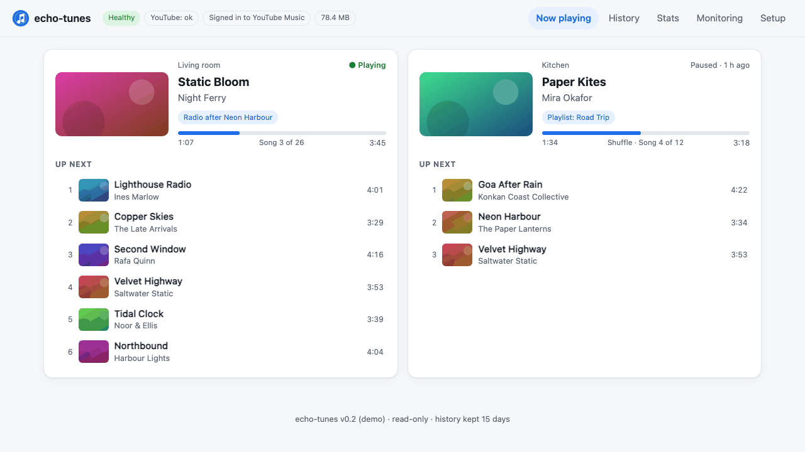
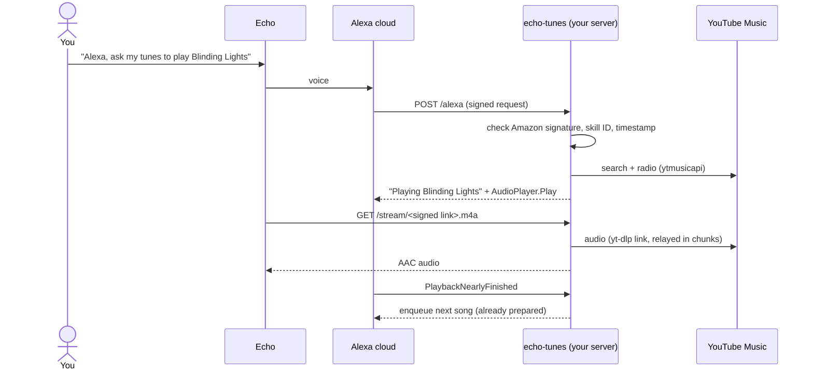

<div align="center">

# echo-tunes

**YouTube Music on your Echo, from your own server.**
A private Alexa skill you host yourself: one Docker container, no AWS account, no Amazon password.

[](https://github.com/denzilrdz/echo-tunes/actions/workflows/ci.yml)
[](https://github.com/denzilrdz/echo-tunes/releases)
[](https://github.com/denzilrdz/echo-tunes/pkgs/container/echo-tunes)
[](https://scorecard.dev/viewer/?uri=github.com/denzilrdz/echo-tunes)
[](LICENSE)

[**Try the dashboard demo**](https://denzilrdz.github.io/echo-tunes/) ·
[Quick start](#quick-start) ·
[Setup guide](docs/SETUP.md) ·
[Public HTTPS options](docs/PUBLIC_HTTPS.md) ·
[Voice commands](docs/VOICE_COMMANDS.md) ·
[Google sign-in](docs/GOOGLE_SIGN_IN.md) ·
[Dashboard](docs/DASHBOARD.md) ·
[Monitoring](docs/MONITORING.md) ·
[How it works](docs/ARCHITECTURE.md) ·
[Troubleshooting](docs/TROUBLESHOOTING.md)

</div>

---

> **"Alexa, ask my tunes to play Blinding Lights."**
> Your Echo plays the song, then keeps going with a radio of similar songs. Next, previous,
> pause, resume, shuffle and loop all work by voice, and from the buttons in the Alexa app.

<picture>
  <source media="(prefers-color-scheme: dark)" srcset="docs/img/dashboard-dark.png" />
  
</picture>

<sub>The private dashboard ([live demo](https://denzilrdz.github.io/echo-tunes/demo/), sample data).</sub>

## Highlights

| Feature                | What you get                                                                                                      |
| ---------------------- | ----------------------------------------------------------------------------------------------------------------- |
| **One container**      | A single Docker image (amd64 and arm64: PCs, cloud servers, Raspberry Pi). No AWS Lambda, no database server.     |
| **No Amazon password** | You create a private skill in the free Alexa developer console. echo-tunes never sees your Amazon login.          |
| **Your own music**     | Optional Google sign-in: "play my liked songs", your playlists, your mixes, "like this song".         |
| **Endless radio**      | Every song starts a YouTube Music radio, and the queue tops itself up so the music doesn't stop.                  |
| **Fast song changes**  | The next song's audio is prepared while the current one plays.                                                   |
| **Runs anywhere**      | Home server behind a tunnel (Tailscale Funnel, Cloudflare Tunnel) or any server with a public IP. Ready examples. |
| **Secure by default**  | Every request's Amazon signature and your skill ID are checked; audio links are signed and expire.                |
| **Flat memory**        | Bounded caches, streamed audio and recycled worker processes: memory doesn't creep up over weeks of uptime.       |
| **Private dashboard**  | Now playing and up next per Echo, 15-day play history, stats, a setup checklist and a "test play" button. [Demo](https://denzilrdz.github.io/echo-tunes/) |
| **Bring your own monitoring** | Prometheus `/metrics`, a JSON health check for Uptime Kuma, and a JSON API for Home Assistant.            |
| **Self-checking**      | `echo-tunes doctor` checks configuration, YouTube access and your public address in one go.                      |
| **Kept up to date**    | A daily job picks up new yt-dlp releases, so YouTube changes are fixed quickly.                                  |

> [!NOTE]
> **Early release.** Tested against real YouTube: voice playback, radio, queue top-up, next and
> previous, pause and resume, playback events and memory over long runs. Google sign-in and
> library playback (liked songs, playlists, mixes) are covered by automated tests but haven't
> been tried with many real accounts yet. Please
> [report problems](https://github.com/denzilrdz/echo-tunes/issues).

## Contents

- [How it compares](#how-it-compares)
- [What you need](#what-you-need)
- [Quick start](#quick-start)
- [How it works](#how-it-works)
- [Configuration](#configuration)
- [FAQ](#faq)
- [Roadmap](#roadmap)
- [Disclaimer](#disclaimer)

## How it compares

|                               | **echo-tunes**                    | Music Assistant + Alexa provider | Bluetooth from a phone |
| ----------------------------- | --------------------------------- | -------------------------------- | ---------------------- |
| Ask Alexa for a song by voice | ✅                                | ❌ (choose songs in its app)     | ❌                     |
| Needs your Amazon password    | ❌                                | ✅ (and a 2FA secret)            | ❌                     |
| Needs AWS / Lambda            | ❌                                | ❌                               | ❌                     |
| Moving parts                  | 1 container (+ your HTTPS tunnel) | Music Assistant + skill service  | A phone nearby         |
| Status                        | Early release                     | Experimental                     | Works today            |

There are other self-hosted YouTube-to-Alexa projects with more features (web remotes,
multiple users, podcasts). echo-tunes aims to be **the simple one**: a small codebase you can
read in an afternoon, set up in about 15 minutes, and then forget about.

## What you need

- **An Echo** (any model with a speaker) and the Amazon account it's registered to.
- **A free Amazon developer account** on that same Amazon account, to create your private skill.
- **A computer that's always on** with Docker: a home server, NAS, Raspberry Pi 4/5 or a cloud server.
- **A public HTTPS address** for it. Alexa only talks to HTTPS on port 443 with a trusted
  certificate. [Pick one of four ways](docs/PUBLIC_HTTPS.md); only the cloud-server option needs
  ports opened.

## Quick start

The full walkthrough is in **[docs/SETUP.md](docs/SETUP.md)**. In short:

**1. Run echo-tunes** behind HTTPS. For example, on a home server with Tailscale:

```bash
mkdir echo-tunes && cd echo-tunes
base=https://raw.githubusercontent.com/denzilrdz/echo-tunes/main
curl -fsSLO $base/examples/tailscale-funnel/compose.yaml
curl -fsSLO $base/examples/tailscale-funnel/serve.json
curl -fsSL $base/.env.example -o .env
# edit .env: ECHO_TUNES_PUBLIC_URL (and the skill ID after step 2); add TS_AUTHKEY=...
docker compose up -d
```

**2. Create your private skill** in the [Alexa developer console](https://developer.amazon.com/alexa/console/ask):
*Create skill* → name **echo tunes** → *Music & Audio* → *Custom* model → *Provision your own* hosting.
Paste the voice model from [`skill-package/`](skill-package/interactionModels/custom) into the
JSON editor, switch on the **Audio Player** interface, and set the endpoint to
`https://<your-public-address>/alexa`.

**3. Put the skill ID in `.env`**, restart, and check everything:

```bash
docker compose up -d
docker compose exec echo-tunes echo-tunes doctor
```

**4. Enable testing** (the skill's *Test* tab → *Development*) and say:
*"Alexa, ask my tunes to play Tum Hi Ho."*

**5. Optional: sign in** so you can say *"play my liked songs"* or *"play my playlist Road Trip"*:

```bash
docker compose exec -it echo-tunes echo-tunes login
```

See [docs/GOOGLE_SIGN_IN.md](docs/GOOGLE_SIGN_IN.md).

**6. Open the dashboard** on the private port (`http://<server>:8081`, or tailnet-only
`https://echo-tunes.<tailnet>.ts.net:8443` with the Funnel example): what's playing, history,
stats, and a setup checklist with a *Test play* button. See [docs/DASHBOARD.md](docs/DASHBOARD.md).

## How it works



More detail, including why audio is relayed and how memory is kept flat, is in
[docs/ARCHITECTURE.md](docs/ARCHITECTURE.md).

## Configuration

All settings are environment variables (or a `.env` file). Only the first two are required.

| Variable                               | Default    | Meaning                                                                     |
| -------------------------------------- | ---------- | --------------------------------------------------------------------------- |
| `ECHO_TUNES_PUBLIC_URL`                | (required) | Public HTTPS address of this server, e.g. `https://music.example.com`.      |
| `ECHO_TUNES_SKILL_IDS`                 | (required) | Your skill ID(s), comma-separated. Requests for other skills are refused.   |
| `ECHO_TUNES_LOCATION`                  | (empty)    | Two-letter country for search results: `US`, `GB`, `IN`, ...                |
| `ECHO_TUNES_LANGUAGE`                  | `en`       | Language for song and artist names.                                         |
| `ECHO_TUNES_RADIO_LENGTH`              | `25`       | Songs a radio adds at a time (5 to 50).                                     |
| `ECHO_TUNES_MAX_QUEUE`                 | `200`      | Longest queue kept per Echo; played songs are dropped first.                |
| `ECHO_TUNES_GOOGLE_CLIENT_ID`          | (none)     | OAuth client for `echo-tunes login` (or type it in at login).               |
| `ECHO_TUNES_GOOGLE_CLIENT_SECRET`      | (none)     | Its secret.                                                                 |
| `ECHO_TUNES_SEND_HISTORY`              | `false`    | When signed in, add played songs to your YouTube history.                   |
| `ECHO_TUNES_YTDLP_COOKIES`             | (none)     | Path to a `cookies.txt` for yt-dlp, if YouTube blocks your server.          |
| `ECHO_TUNES_RESOLVER_WORKERS`          | `2`        | Parallel workers that prepare audio links.                                  |
| `ECHO_TUNES_RESOLVER_TASKS_PER_WORKER` | `25`       | Songs a worker prepares before a fresh one replaces it (frees memory).      |
| `ECHO_TUNES_STREAM_LINK_TTL_HOURS`     | `12`       | How long an audio link given to the Echo stays valid.                       |
| `ECHO_TUNES_DASHBOARD_PORT`            | `8081`     | Private dashboard, `/metrics` and JSON API (`0` = off). Never publish it. |
| `ECHO_TUNES_DASHBOARD_PASSWORD`        | (none)     | Optional password for the dashboard (user `admin`).                         |
| `ECHO_TUNES_HISTORY_DAYS`              | `15`       | Days of play history to keep (`0` = keep none).                             |
| `ECHO_TUNES_DEVICE_NAMES`              | (none)     | Friendly Echo names: `BEWY4D23ORJQ=Living room,…` ([how](docs/DASHBOARD.md#naming-your-echos)). |
| `ECHO_TUNES_LOG_LEVEL`                 | `info`     | `debug`, `info`, `warning` or `error`.                                      |
| `ECHO_TUNES_PORT`                      | `8080`     | Port inside the container.                                                  |

Data (player queues, the key that signs audio links, your sign-in token, yt-dlp's cache) lives
in `/data`; back it up and keep it private.

## FAQ

**Do I need YouTube Premium?** No. Songs play without an account. Signing in (optional) only
adds your own library: liked songs, playlists and mixes.

**Are there ads?** echo-tunes plays the song's audio file directly, so nothing is inserted between songs.

**Can I just say "Alexa, play ..." without "ask my tunes"?** No. Amazon only lets its built-in
music services answer that; a private skill is always called by name. An Alexa routine can give
you a shorter phrase.

**Will it work on a cloud server?** Yes, but YouTube is much stricter with data-centre IP
addresses and may ask them to "sign in to confirm you're not a bot". A home server is the most
reliable. See [Troubleshooting](docs/TROUBLESHOOTING.md#youtube-blocks-a-cloud-server).

**Can my family use it?** Anyone using Echos on your Amazon account, yes. For other Amazon
accounts, invite them as beta testers of your skill in the developer console.

**Why not publish it in the Alexa Skill Store?** Amazon doesn't certify skills that play YouTube
content, so each person runs their own private copy. That's also why it's self-hosted.

## Roadmap

- [x] Voice playback, radio, queue, playback controls, Docker image, docs
- [x] Sign in with Google: your playlists, liked songs, mixes and personal radio
- [x] Private dashboard: now playing, history, stats, setup checklist and test play
- [x] Prometheus metrics and a health check for Uptime Kuma
- [ ] More languages for the voice model (German, Spanish, French, ...): contributions welcome

## Contributing

Bug reports and pull requests are welcome: see [CONTRIBUTING.md](CONTRIBUTING.md). For security
problems, please follow [SECURITY.md](SECURITY.md) instead of opening an issue.

## Disclaimer

echo-tunes is an independent project for personal use. It is not affiliated with, endorsed by
or sponsored by Amazon or Google. "Alexa", "Echo" and "YouTube Music" are trademarks of their
owners. It builds on the open-source [yt-dlp](https://github.com/yt-dlp/yt-dlp) and
[ytmusicapi](https://github.com/sigma67/ytmusicapi) projects. Using it may conflict with
YouTube's Terms of Service; you are responsible for how you use it.

## License

[MIT](LICENSE)
