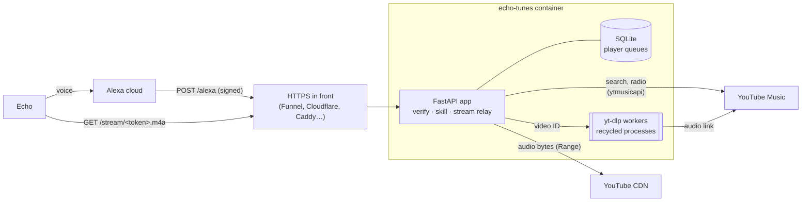

# How echo-tunes works

## The pieces

| Module | Job |
| --- | --- |
| [`alexa/verify.py`](../src/echo_tunes/alexa/verify.py) | Checks every request is really from Alexa: certificate URL rules, certificate chain and name (`echo-api.amazon.com`), RSA-SHA256 signature of the body, timestamp within 150 s, your skill ID. |
| [`alexa/skill.py`](../src/echo_tunes/alexa/skill.py) | Voice intents, AudioPlayer events and hardware buttons → Alexa responses. One lock per Echo keeps its events in order. |
| [`music/catalog.py`](../src/echo_tunes/music/catalog.py) | Search and radio from YouTube Music via ytmusicapi. |
| [`music/resolver.py`](../src/echo_tunes/music/resolver.py), [`extract.py`](../src/echo_tunes/music/extract.py) | Turns a video ID into a direct AAC audio link with yt-dlp, in separate worker processes. |
| [`stream.py`](../src/echo_tunes/stream.py) | Relays audio to the Echo, honouring `Range` requests. |
| [`player/`](../src/echo_tunes/player) | Each Echo's queue, position, shuffle and loop, stored in SQLite. |
| [`tokens.py`](../src/echo_tunes/tokens.py) | Signed, expiring stream links. |
| [`history.py`](../src/echo_tunes/history.py) | Play history in SQLite, pruned after `ECHO_TUNES_HISTORY_DAYS`. |
| [`dashboard.py`](../src/echo_tunes/dashboard.py), [`web/`](../src/echo_tunes/web) | The private dashboard, player and its JSON API, on a second port (actions need the password). |
| [`metrics.py`](../src/echo_tunes/metrics.py) | Prometheus metrics with fixed label values. |
| [`checks.py`](../src/echo_tunes/checks.py) | Setup checks shared by `echo-tunes doctor` and the dashboard. |

## A song, step by step

1. **"Alexa, ask my tunes to play Blinding Lights."** Alexa sends a signed `IntentRequest`
   (`PlayIntent`, `query = "blinding lights"`) to `POST /alexa`.
2. echo-tunes verifies it, searches YouTube Music, and **immediately starts preparing the audio
   link** in a worker. While that runs it fetches a radio of similar songs and saves the queue.
3. It answers with speech and an `AudioPlayer.Play` directive whose URL is
   `https://<you>/stream/<video>.<expiry>.<signature>.m4a`.
4. The Echo requests that URL. echo-tunes checks the signature, waits for the link (usually
   ready by now), and relays the bytes from YouTube's CDN.
5. Alexa reports `PlaybackStarted` → echo-tunes prepares the **next** song's link in the background.
6. Near the end, Alexa sends `PlaybackNearlyFinished` → echo-tunes answers with an `ENQUEUE`
   directive for the next song, so it starts without a gap. If the queue is nearly empty, it
   first adds more songs from a radio.

## Design decisions

**Why relay the audio instead of giving the Echo YouTube's link?** YouTube's links are tied to
the IP address that asked for them, expire after a few hours, and (as of late 2026) answer
`403 Forbidden` for the first two seconds or so after they're issued. A stable, signed link to
echo-tunes hides all of that: it retries through the warm-up, re-fetches expired links, and
resumes from the right byte after a network blip.

**Why does yt-dlp run in separate processes?** yt-dlp is large, keeps caches, and runs Deno to
solve YouTube's JavaScript challenges. Running it in a small pool of worker processes keeps the
web server responsive, and each worker is **replaced after a fixed number of songs**
(`ECHO_TUNES_RESOLVER_TASKS_PER_WORKER`), which returns any memory it accumulated to the
operating system.

**Why does it need Deno?** Since November 2025 yt-dlp needs a JavaScript runtime to read
YouTube. The image includes Deno, the runtime yt-dlp enables by default.

**Why its own request verification instead of Amazon's Python SDK?** The SDK's verifier keeps
every downloaded certificate in an unbounded dictionary, downloads with no timeout, and depends
on unmaintained crypto libraries. echo-tunes implements the same published rules with the
`cryptography` package's certificate verifier, a 4-entry cache, a 5-second timeout and a size
limit.

## Memory: why it stays flat

Long-running Python services often grow because something keeps a little of every request.
echo-tunes is built so nothing does:

| Thing that could grow | How it's bounded |
| --- | --- |
| Audio links, search results, certificates | Fixed-size LRU caches with expiry ([`cache.py`](../src/echo_tunes/cache.py)) |
| Songs being streamed | Passed through in 64 KB chunks; YouTube is asked for at most 8 MB per request; nothing is buffered |
| Player queues | On disk in SQLite, max 200 songs per Echo, max 50 Echos (oldest forgotten) |
| Play history | On disk in SQLite, deleted after `ECHO_TUNES_HISTORY_DAYS` (default 15) |
| Metrics | Fixed label values only (no song titles or device IDs), so a constant number of series |
| Per-Echo locks | Weak references: a lock disappears when nobody's waiting on it |
| Background "prepare next song" tasks | Removed from their set when done; duplicates skipped |
| yt-dlp / Deno | Separate processes, recycled every N songs |
| glibc memory fragmentation | `MALLOC_ARENA_MAX=2` in the image |

This is enforced by a [soak test](../tests/test_memory.py) that runs 300 rounds of play,
events, skips and streams across 80 simulated Echos and fails if Python memory grows by more
than 512 KB. It runs on every pull request. The container also has a 512 MB memory limit in
the example compose files as a safety net.

## Security

- `/alexa` accepts only requests signed by Amazon for **your** skill ID, at most 150 seconds
  old and 256 KB in size; anything else gets `400`.
- `/stream/…` links are HMAC-signed with a key generated on first start (`/data/stream.key`)
  and expire, so the server can't be used as an open proxy to YouTube.
- The public port has no other endpoints besides `/` and `/healthz` (no admin UI, no API docs).
- The dashboard, its JSON API and `/metrics` live on a **separate port** (8081) that the public
  tunnel or proxy never forwards. Its actions (play, queue, clear history) need the password
  and a same-origin JSON request. It sends strict security headers (a content security policy
  allowing only its own scripts) and builds every piece of text with `textContent` (song titles
  can't inject markup).
- The container runs as a non-root user on a read-only filesystem with all capabilities dropped.
