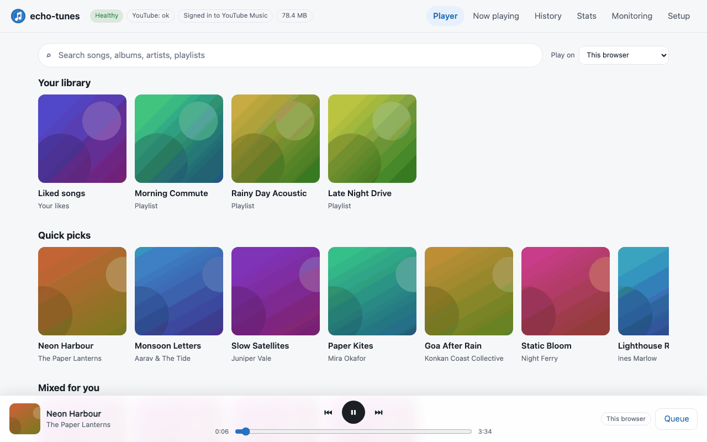
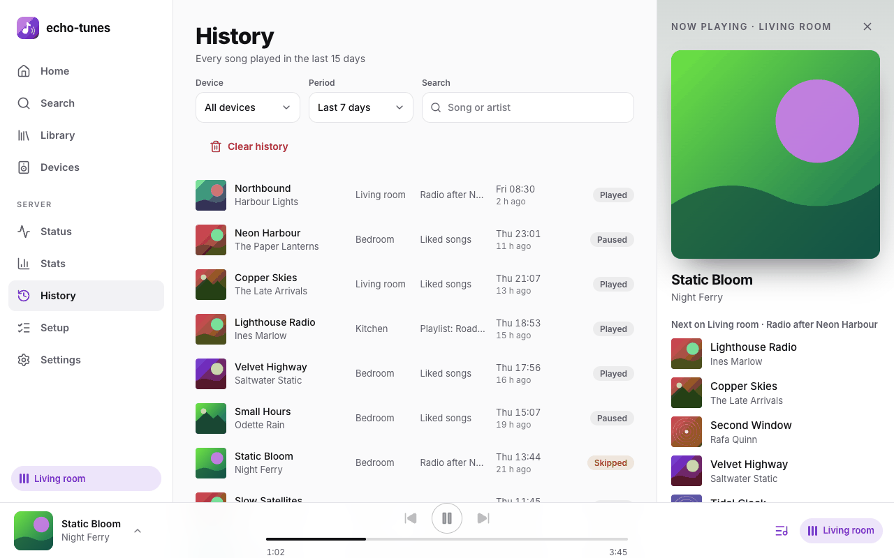
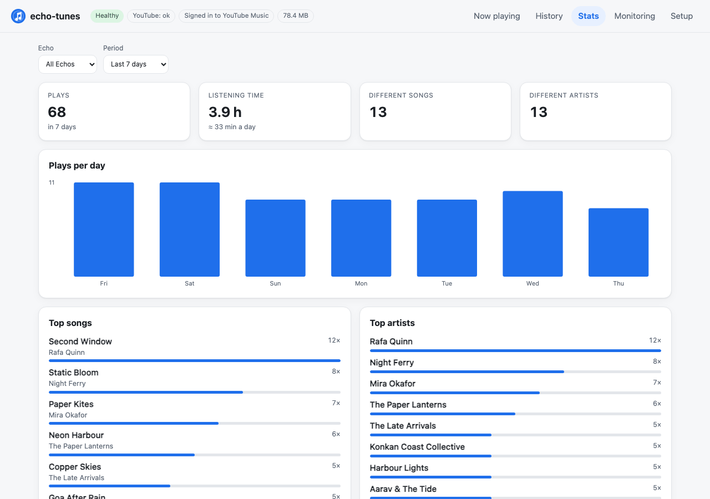
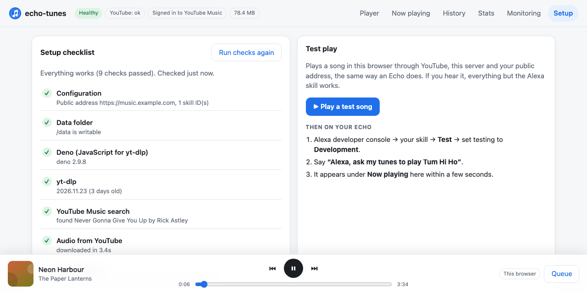

# Dashboard and player

A private web app: search and play YouTube Music in your browser or line songs up on an Echo,
see what every Echo is playing, your history and stats. Add it to your phone's home screen and
it works like an app. **[Try the demo](https://denzilrdz.github.io/echo-tunes/demo/)** (sample
data, nothing plays).

<picture>
  <source media="(prefers-color-scheme: dark)" srcset="img/player-dark.png" />
  
</picture>

| Tab | What you see |
| --- | --- |
| **Player** | Search songs, albums, artists and playlists; browse quick picks, your mixes and library (when signed in), trending charts, top artists and moods & genres. Play in this browser (with a queue, radio that keeps going, and lock-screen controls) or choose an Echo under **Play on** to queue songs there. |
| **Now playing** | Each Echo's song with artwork and a live progress bar, why it's playing ("Asked for …", "Radio after …", "Playlist: …"), shuffle/loop, and the next 10 songs. Playing Echos come first. |
| **History** | Every song played in the last 15 days (configurable): when, which Echo, why, how long it was listened to, and whether it finished, was skipped, paused or failed. Filter by Echo and period, search by song or artist. |
| **Stats** | Plays, listening time, different songs and artists, plays per day, top songs and top artists, for a chosen period and Echo. |
| **Monitoring** | Health at a glance, plus copy-ready settings for Uptime Kuma, Prometheus and Home Assistant ([MONITORING.md](MONITORING.md)). |
| **Setup** | The same checklist as `echo-tunes doctor` (configuration, YouTube, your public address, "has Alexa reached this server?"), and a **Test play** button that plays a song in your browser through YouTube, this server and your public address, exactly like an Echo. |

<picture>
  <source media="(prefers-color-scheme: dark)" srcset="img/history-dark.png" />
  
</picture>

<picture>
  <source media="(prefers-color-scheme: dark)" srcset="img/stats-dark.png" />
  
</picture>

<picture>
  <source media="(prefers-color-scheme: dark)" srcset="img/setup-dark.png" />
  
</picture>

## Player

**Play on: This browser.** The song streams from your server through your public address,
like on an Echo. When the queue runs out, a radio of similar songs keeps it going. Media keys
and your phone's lock screen control it. Songs played here appear in the history as
*dashboard-browser*.

**Play on: an Echo.** Alexa only lets a skill change what an Echo plays when the Echo checks in
(when a song starts or is about to end); a web page can't push to it. So:

| Button | On an Echo |
| --- | --- |
| **▶ Play** | Plays after the current song. If the Echo had already lined up its next song, it switches as soon as that one starts. If the Echo is paused, saying "resume" plays it. A newer voice request wins over it. |
| **Next** | After whatever the Echo plays next: right after the current song, or after the song the Echo has already lined up. |
| **+** (Add to queue) | At the end of the queue. |
| **Radio** | A radio of similar songs, after the current song. |

The Echo must be playing (or paused) something from echo-tunes; start it by voice the first
time. Pause, resume and previous stay with your voice and the Echo's buttons.

**Skip now (experimental).** With `ECHO_TUNES_EXPERIMENTAL_SKIP=true`, the ⏭ button on an Echo
cuts the current song's audio stream, so the Echo gives up on it and plays the next. It only
works while the Echo is still downloading the song (Echos often fetch a whole song early), so
it may do nothing; it's off by default.

**Actions need a password.** Browsing works on any private network, but anything that changes
something (play, queue, skip, the setup page's test play, clear history) only works when
`ECHO_TUNES_DASHBOARD_PASSWORD` is set. It's then a JSON request from the dashboard's own page (other websites can't trigger
it).

**Sign in once per device.** With a password set, the dashboard shows a sign-in page; after
that the phone, browser or installed app stays signed in for 180 days, or until you sign out
with `ECHO_TUNES_DASHBOARD_SESSION_DAYS=0`. Wrong passwords are answered one at a time, a
second each, so guessing is slow. *Sign out* ends that device's session on the server too (a
copied cookie stops working); `POST /api/logout/all` signs every device out, and so does
changing the password. Lowering `ECHO_TUNES_DASHBOARD_SESSION_DAYS` also shortens sessions
already signed in. Sessions are kept in `sessions.json` (at most 100) and signed with
`session.key`, both in the data folder.

**Scripts and monitors** use `ECHO_TUNES_DASHBOARD_API_TOKEN` (recommended: a long random
value, e.g. `openssl rand -hex 32`, sent as `Authorization: Bearer <token>`). It skips the
password checks, so a flood of wrong passwords on your network can't make your monitors fail.
HTTP Basic auth with the password (`curl -u admin:PASSWORD`) still works. See
[MONITORING.md](MONITORING.md).

## Install it as an app

The dashboard is a progressive web app. Open it over **HTTPS** (browsers only install apps from
secure addresses, e.g. Tailscale Serve, Caddy with a LAN certificate, or `localhost`), then:

- **Android (Chrome):** menu → *Install app* (or *Add to Home screen*).
- **iPhone/iPad (Safari):** Share → *Add to Home Screen*.
- **Desktop (Chrome, Edge):** the install icon in the address bar.

It opens full screen with its own icon. Change how it looks without touching code:

| Variable | Default | Meaning |
| --- | --- | --- |
| `ECHO_TUNES_APP_NAME` | `echo-tunes` | Name under the icon and in the title bar. |
| `ECHO_TUNES_APP_COLOR` | `#1f6feb` | Theme colour (`#rrggbb`), used by the phone's status bar. |
| `ECHO_TUNES_APP_ICON` | (built in) | Path to your own square PNG (512×512 or larger, under 2 MB), e.g. `/data/icon.png`. |

## Safety

It only answers to IP addresses, `localhost`, your public URL's name and names listed in
`ECHO_TUNES_DASHBOARD_HOSTS`, and refuses background requests from other websites. That stops
a malicious web page from reading it through your browser (DNS rebinding).

## Where it is

It runs on a **second port, 8081**, separate from the public port 8080 that Amazon and your Echo
use. Your HTTPS tunnel or reverse proxy only forwards the public port, so the dashboard stays
private as long as you don't publish 8081 to the internet yourself.

| Setup | Open the dashboard at |
| --- | --- |
| Plain `compose.yaml` | `http://localhost:8081` on the server (or `ssh -L 8081:localhost:8081 server` and open it on your computer) |
| [Tailscale Funnel example](../examples/tailscale-funnel) | `https://echo-tunes.<your-tailnet>.ts.net:8443`, **from your tailnet only** (Tailscale Serve, not Funnel) |
| [Cloudflare Tunnel](../examples/cloudflare-tunnel) / [Caddy](../examples/caddy) | `http://localhost:8081` on the server or over SSH; don't add a public hostname for it |

> [!WARNING]
> Never route port 8081 through Funnel, a Cloudflare public hostname or a public reverse proxy
> without a password: it shows what you listen to. If you need it on a shared network, set
> `ECHO_TUNES_DASHBOARD_PASSWORD` (browsers then get a sign-in page; it applies to `/metrics`
> and the JSON API too).

## Settings

| Variable | Default | Meaning |
| --- | --- | --- |
| `ECHO_TUNES_DASHBOARD_PORT` | `8081` | Port of the dashboard, `/metrics` and the JSON API. `0` turns it off. |
| `ECHO_TUNES_DASHBOARD_HOST` | `127.0.0.1` (`0.0.0.0` in the Docker image) | Address it listens on. The image listens on all interfaces so the port can be published; publish it privately. |
| `ECHO_TUNES_DASHBOARD_HOSTS` | (none) | Extra host names you open it by, comma-separated (e.g. `music-dash.lan`). IP addresses, `localhost` and your public URL's name always work; other names are refused. |
| `ECHO_TUNES_DASHBOARD_PASSWORD` | (none) | Password: sign-in page for browsers, HTTP Basic (user `admin`) for scripts. Needed for the player's actions. |
| `ECHO_TUNES_DASHBOARD_SESSION_DAYS` | `180` | How long a device stays signed in. `0` = until you sign out or change the password. |
| `ECHO_TUNES_DASHBOARD_API_TOKEN` | (none) | Bearer token for monitors and scripts (at least 32 characters). Skips the password checks. |
| `ECHO_TUNES_HISTORY_DAYS` | `15` | Days of play history to keep. `0` keeps none (and deletes what's there). |
| `ECHO_TUNES_DEVICE_NAMES` | (none) | Friendly names, e.g. `LIVINGROOM01=Living room,K1TCHEN0ECHO=Kitchen`. |
| `ECHO_TUNES_EXPERIMENTAL_SKIP` | `false` | Let the player try to skip the song playing on an Echo (see [Player](#player)). |

### Naming your Echos

Alexa only tells a skill a long, random device ID. The dashboard shows its last 12 characters
(for example *Echo …NGROOM01*). Copy that from the Now playing tab or the History Echo filter and
set `ECHO_TUNES_DEVICE_NAMES=LIVINGROOM01=Living room`, then restart.

## History and privacy

- Stored in `history.sqlite3` in the data folder: song, artist, which Echo, when, why, how long.
- Rows older than `ECHO_TUNES_HISTORY_DAYS` are deleted automatically (checked hourly and at
  start), so the file stays small: about 1 KB per song played.
- **Clear history** (History tab, needs the password) deletes every play at once, and the
  space it used.
- Nothing is sent anywhere. Artwork is loaded by your browser from Google's image servers
  (`i.ytimg.com`, `*.googleusercontent.com`), like on YouTube Music itself.

## JSON API

Everything the page shows comes from JSON endpoints on the same port, handy for scripts and
home automation. With a password set, send the API token (`Authorization: Bearer …`) or Basic
auth. POSTs must be JSON (`Content-Type: application/json`, at most 256 KB); those marked
*action* also need the password to be set.

| Endpoint | Returns |
| --- | --- |
| `GET /api/now` | Each Echo: current song, position, playing/paused, source, next 10 songs |
| `GET /api/history?days=7&device=…&q=…&limit=50&offset=0` | Plays, newest first (`device=browser` for the web player) |
| `GET /api/stats?days=7&device=…&tz=…` | Totals, plays per day, top songs and artists (`tz`: minutes east of UTC) |
| `GET /api/devices` | Known Echos (ID tail and name), and `browser` ("Web player") once it has played something |
| `GET /api/health` | Health summary (see [MONITORING.md](MONITORING.md)) |
| `GET /api/setup?refresh=1` | The setup checklist (cached for a minute) |
| `GET /metrics` | Prometheus metrics |
| `GET /api/player` | Echos the player can send to, and whether actions are allowed |
| `GET /api/search?q=…&kind=song\|album\|artist\|playlist` | YouTube Music search |
| `GET /api/browse/home`, `/api/browse/explore`, `/api/browse/library` | Home rows, charts and moods, your playlists |
| `GET /api/browse/mood?params=…` | Playlists of a mood or genre |
| `GET /api/browse/tracks?kind=…&id=…` | The songs of a playlist, album, artist, or a song's radio |
| `POST /api/play/echo` `{"device", "mode": "now\|next\|queue", "tracks": [...]}` | Queue songs on an Echo (action) |
| `POST /api/play/skip` `{"device"}` | Experimental skip on an Echo (action) |
| `POST /api/play/stream-link` `{"video_id"}` | A signed link to play a song in this browser (action) |
| `POST /api/play/played` `{"track", "source"}` | Record a song played in the browser in the history (action) |
| `POST /api/test-play` `{}` | A 10-minute link to a test song, for the setup page (action) |
| `POST /api/history/clear` `{}` | Delete the history (action) |
| `POST /api/login` `{"password"}` | Sign in (sets the session cookie) |
| `POST /api/logout` `{}` | Sign this browser out |
| `POST /api/logout/all` `{}` | Sign every browser out |

Pages and files: `/` (the dashboard), `/login`, `/manifest.webmanifest`, `/sw.js`,
`/app-icon.png` (with `ECHO_TUNES_APP_ICON`) and `/static/…`.
